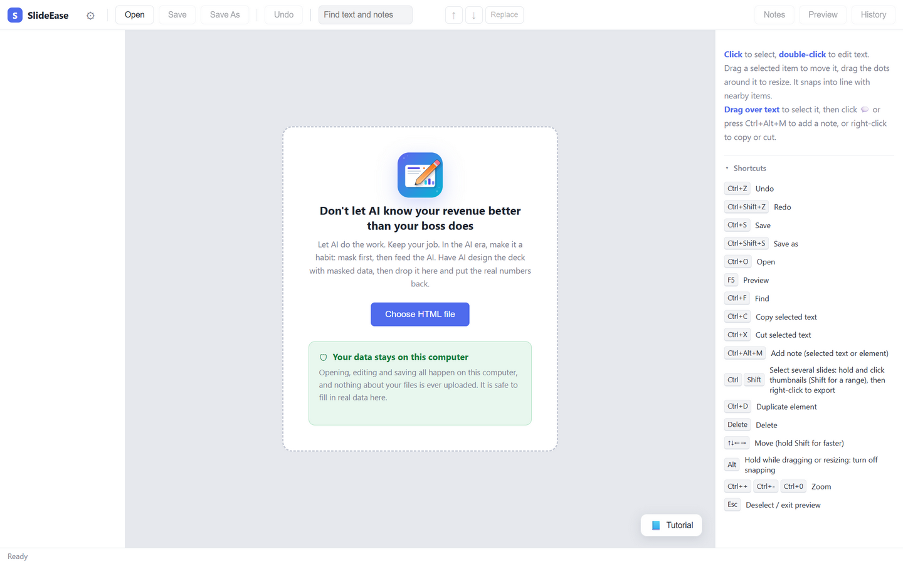
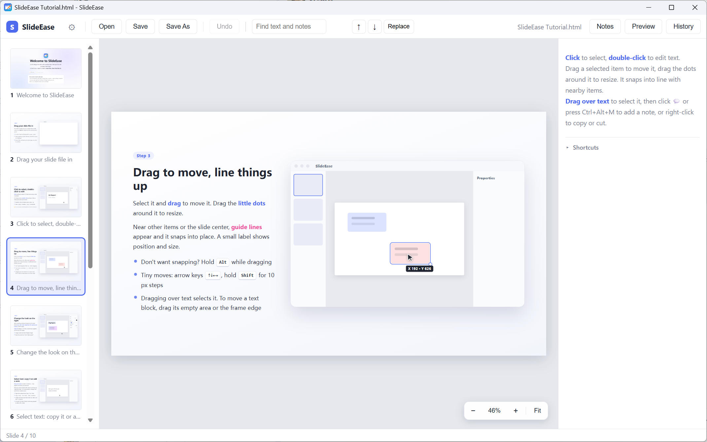

# SlideEase

[](https://github.com/open-workbox/SlideEase/actions/workflows/release.yml)
[](https://github.com/open-workbox/SlideEase/releases/latest)
[](https://github.com/open-workbox/SlideEase/releases)
[](LICENSE)

[English](#english) · [简体中文](#简体中文) · [繁體中文](#繁體中文) · [日本語](#日本語) · [Español](#español) · [Français](#français)

**👉 How it works, FAQ and changelog are on the website: https://7na7.com/**

  
  

- Download: [GitHub Releases](https://github.com/open-workbox/SlideEase/releases). Windows (installer / portable zip), macOS (Apple Silicon / Intel), Linux (AppImage / deb)

### Install with AI / 交给 AI 安装

You can let an AI assistant install it for you. Copy the line below into an assistant that can use your computer (Claude, Codex, Cursor, Copilot and so on). It will download and install SlideEase without asking you to click through anything. Full guide: https://7na7.com/install.html

不想自己装，可以交给 AI。把下面这句复制给能操作你电脑的 AI（Claude、Codex、Cursor、Copilot 等），它会自己下载、安装，中间不用你点确认。完整说明见上面的链接。

```
Please read the install steps at https://7na7.com/install.html and install SlideEase on my computer by following them, doing everything via the terminal without asking me to confirm.
```

---

## English

**Don't let AI know your revenue better than your boss does.**

Let AI do the work. Keep your job. In the AI era, make it a habit: **mask first, then feed the AI.**

Let AI design the deck with masked data, then put the real numbers back in SlideEase. Edit text, pictures and layout just like in PowerPoint. SlideEase is a free desktop app, and no code is needed.

- The AI only ever sees masked data. You type the real figures, names and clients locally
- Double-click to change text, drag to move things, guide lines help you line them up
- Leave notes on the masked version and hand it back to AI with "apply the notes"
- Every change is recorded and can be undone one at a time; saving packs the images into one HTML file

> **Nothing about your files is ever uploaded.** Opening, editing and saving all happen on your computer.

## 简体中文

**别让 AI 比你老板还清楚公司营收。**

效率交给 AI，饭碗留给自己。AI 时代，数据保密要养成习惯：**先脱敏，再喂 AI。**

先用脱敏数据让 AI 排好版、出幻灯片，再在 SlideEase 里把真实数据填回去。改字、换图、调位置，像改 PPT 一样。SlideEase 是一款免费的桌面软件，不用懂代码。

- AI 只拿到脱敏数据，真实的数字、人名、客户名都在本机填
- 双击改字，拖动换位置，参考线帮你对齐
- 在脱敏版本上写批注，交回 AI 时说一句“按批注改”
- 每一步改动都有记录，可以一条一条撤回；保存时图片合并进同一个 HTML

> **不会上传你的任何文件信息和内容。** 打开、编辑、保存都在你的电脑上完成。

## 繁體中文

**別讓 AI 比你老闆還清楚公司營收。**

效率交給 AI，飯碗留給自己。AI 時代，資料保密要養成習慣：**先去識別化，再餵給 AI。**

先用去識別化的資料讓 AI 排好版、做出簡報，再在 SlideEase 裡把真實資料填回去。改字、換圖、調位置，像改 PPT 一樣。SlideEase 是一款免費的桌面軟體，不必懂程式。

- AI 只拿到去識別化的資料，真實的數字、人名、客戶名都在本機填寫
- 雙擊改字，拖曳移動，參考線幫你對齊
- 在去識別化的版本上寫註解，交回 AI 時說一句「照註解改」
- 每一步修改都有紀錄，可以一條一條復原；儲存時圖片會合併進同一個 HTML

> **不會上傳你的任何檔案資訊與內容。** 開啟、編輯、儲存都在你的電腦上完成。

## 日本語

**会社の売上、上司より先に AI に知られていませんか。**

作業は AI に任せても、自分の仕事は守りましょう。AI 時代のデータ保護は習慣にしたいもの：**マスキングしてから AI へ。**

マスキングしたデータで AI にレイアウトとスライドを作ってもらい、SlideEase で本物のデータに書き戻します。文字の修正、画像の差し替え、位置の調整は PowerPoint と同じ感覚で。SlideEase は無料のデスクトップアプリで、コードは不要です。

- AI が見るのはマスキング済みのデータだけ。本当の数字、氏名、取引先はローカルで入力します
- ダブルクリックで文字を編集、ドラッグで移動、ガイド線で位置をそろえられます
- マスキング版にメモを残し、AI に「メモのとおりに直して」と渡せます
- すべての変更が記録され一つずつ取り消せます。保存すると画像も一つの HTML ファイルにまとまります

> **ファイルの情報や内容がアップロードされることは一切ありません。** 開く、編集する、保存する、すべてあなたのパソコン上で行われます。

## Español

**Que la IA no sepa más de tus ventas que tu jefe.**

Deja el trabajo a la IA y quédate con tu puesto. En la era de la IA, conviértelo en hábito: **primero anonimiza, después dáselo a la IA.**

Haz que la IA diseñe la presentación con datos anonimizados y luego vuelve a poner las cifras reales en SlideEase. Edita textos, imágenes y diseño como en PowerPoint. SlideEase es una aplicación de escritorio gratuita y no necesitas saber programar.

- La IA solo ve datos anonimizados. Las cifras, nombres y clientes reales los escribes en local
- Doble clic para editar el texto, arrastra para mover y las guías te ayudan a alinear
- Deja notas en la versión anonimizada y devuélvela a la IA con un «aplica las notas»
- Cada cambio queda registrado y se puede deshacer uno por uno; al guardar, las imágenes quedan dentro de un solo HTML

> **Nunca se sube ninguna información ni contenido de tus archivos.** Abrir, editar y guardar ocurre en tu ordenador.

## Français

**Ne laissez pas l'IA connaître votre chiffre d'affaires mieux que votre patron.**

Confiez le travail à l'IA, gardez votre poste. À l'ère de l'IA, prenez l'habitude : **anonymisez d'abord, donnez à l'IA ensuite.**

Laissez l'IA concevoir les diapositives avec des données anonymisées, puis remettez les vrais chiffres dans SlideEase. Modifiez textes, images et mise en page comme dans PowerPoint. SlideEase est une application de bureau gratuite, sans code.

- L'IA ne voit que des données anonymisées. Les vrais chiffres, noms et clients sont saisis en local
- Double-cliquez pour modifier le texte, glissez pour déplacer, les repères vous aident à aligner
- Laissez des notes sur la version anonymisée et rendez-la à l'IA avec un « applique les notes »
- Chaque modification est enregistrée et peut être annulée une par une ; à l'enregistrement, les images sont intégrées dans un seul HTML

> **Aucune information ni aucun contenu de vos fichiers n'est jamais envoyé.** L'ouverture, la modification et l'enregistrement se font sur votre ordinateur.

---

## Run from source

```bash
npm install
npm start
```

## Build

```bash
npm run dist       # installer and portable for the current platform, output to dist/
```

## Project structure

```
main.js            Main process: window, file I/O, capture, background thumbnails, loading overlay, file association, analytics, updates
preload.js         Minimal API exposed to the page
history.js         Local storage for edit history (append log + compressed snapshots)
analytics.js       Anonymous usage analytics
updater.js         Update check
renderer/
  index.html       UI
  styles.css       Styles
  app.js           Core: loading, select / drag / zoom / text editing, undo stack, properties panel, save, preview
  source.js        Element ids; replays changes onto the original document on save
  slides.js        Slide detection and switching
  inline.js        Merges relative-path resources on save
  find.js          Find & replace
  historyui.js     Edit-history panel, locate, single-entry revert, checkpoint restore
  notes.js         Notes panel, markers and the note popup; notes are saved inside the HTML
  selmenu.js       Text selection: the 💬 button, right-click menu, copy / cut
  guides.js        Guide lines and snapping while dragging or resizing
  exporter.js      Export slides as PNG images or single-slide HTML
  i18n.js          Chinese / English strings
  shortcuts.js     The single shortcut config: key handling, help lists and the tutorial all read it
  tutorial.js      Prepares the built-in tutorial (language, shortcut keys from shortcuts.js)
  tutorial/        The built-in tutorial deck (an HTML slide deck with animated demos)
docs/              Website (GitHub Pages)
scripts/           Packaging scripts
```

## Privacy & anonymous analytics

SlideEase sends a small amount of anonymous usage data (PostHog) so we can see which versions and operating systems are in use, how many people use it each day, and whether an update is available. It reports only the app version, a random device id, OS type, architecture, locale and a few feature event names. It never reports file names, paths, slide content or what you changed. If you build and distribute your own copy, replace the key and host in `analytics.js`.

## License

[Apache License 2.0](LICENSE)
